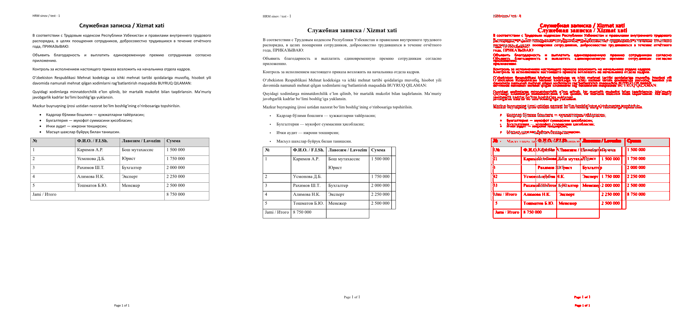
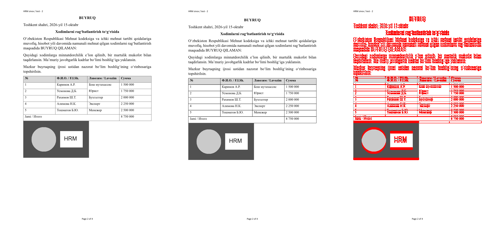
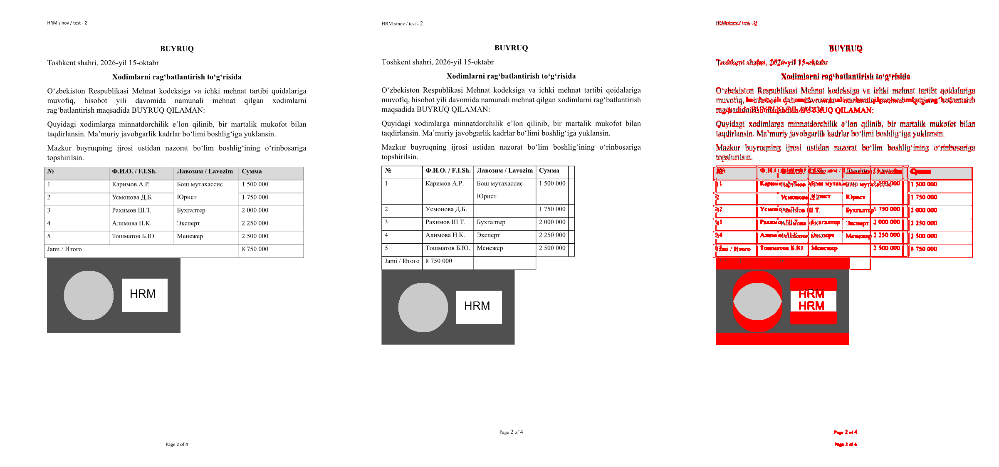
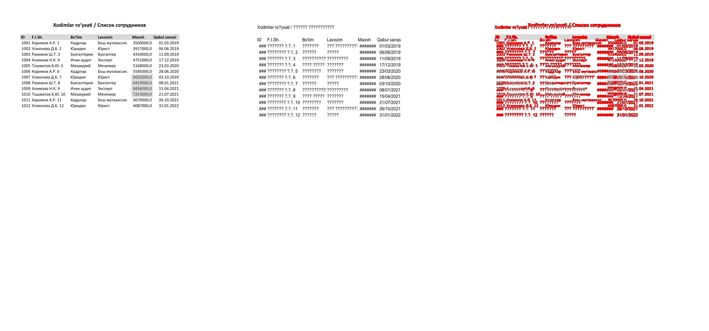
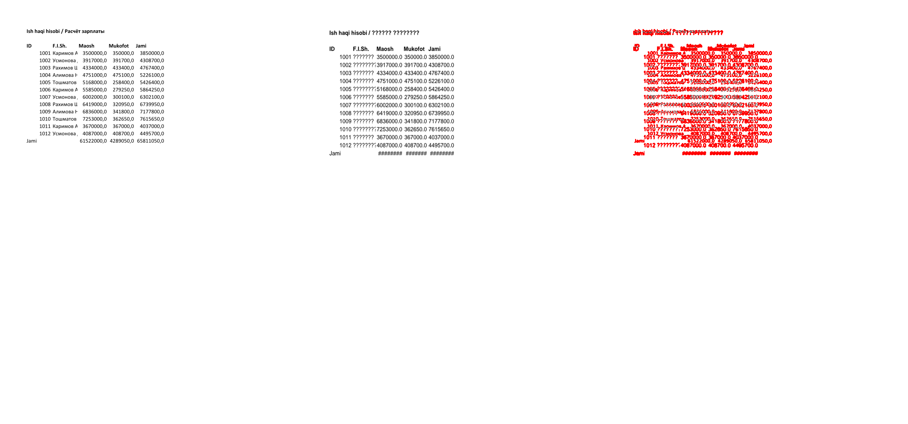
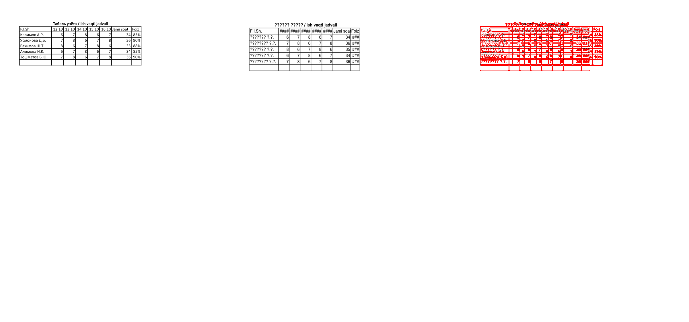

# Fidelity baseline (Phase 0, task 5 prep)

> **SYNTHETIC set, produced by Microsoft Office 16.** The owner's anonymised `corpus/` run is **pending**.
> All numbers below come from `spikes/fidelity/run.py` runs on 2026-10-16 09:26:09; none are about real HRM documents.

Corpus run command (artefacts go under `E:/` only; names are replaced by ids):

```
python -I spikes/fidelity/run.py --input corpus/ --out E:/office-target/fidelity-corpus
```

## Method

- Test set: `spikes/fidelity/gen_office.ps1` drives Word/Excel/PowerPoint through COM and saves each document as modern (`docx/xlsx/pptx`) and legacy (`doc/xls/ppt`) files (10 files, synthetic text incl. Uzbek Cyrillic/Latin with U+02BB/U+02BC, Russian).
- Reference ("truth"): the same Office 16 opens the file read-only and exports PDF (`ExportAsFixedFormat` / `SaveAs 32`).
- Candidate, per file: Craft CLI `direct` = open -> PDF; `roundtrip` = open -> save native format -> reopen -> PDF. Excel PDFs use `file.exportPdf` with `sheets:all`; deckcraft saves with `run --save`.
- All PDFs (reference and candidates) are rasterised by the same `pdfcraft-cli render --dpi 96`; pixel diff = grayscale, Gaussian blur r=1, |a-b|>48 counted as different; pages compared by index for pages present in both (a page-count mismatch therefore inflates later pages; read it together with the pagination loss).

- Text similarity: `pdfcraft-cli text` on both PDFs, NFKC + casefold + whitespace-normalised, U+02BB/U+02BC/U+2019 folded to `'`; ratio = difflib SequenceMatcher (character level). Missing words = multiset difference of word tokens.
- Office reopen: the Craft-saved file is opened read-only in Office via COM with alerts suppressed; failure to open = not ok. A silent auto-repair by Excel is not detectable this way (limitation).
- Structural counts (before = original in Office, after = Craft-saved file in Office): Word paragraphs/tables/images/bookmarks/fields/header+footer fields/comments/revisions/footnotes/sections; Excel sheets/formulas/charts/conditional formats/names; PowerPoint slides/shapes/tables/pictures/charts/notes.
- Hooks for LibreOffice and ONLYOFFICE x2t references exist (`libreoffice_reference`, `x2t_reference` in run.py) but were not run (Docker down).

## Versions

| Component | Version |
|---|---|
| office | Office16 (version unknown) |
| pdfcraft-cli | pdfcraft-cli 0.8.0 |
| release/wordcraft-cli | wordcraft-cli 0.7.0 |
| release/wordcraft-cli mtime | 2026-10-14 13:36 |
| release/wordcraft-cli sha256 | c28bcf13a8960cce |
| release/gridcraft-cli | gridcraft-cli 0.7.0 |
| release/gridcraft-cli mtime | 2026-10-14 14:18 |
| release/gridcraft-cli sha256 | 8ca1844f5b892db9 |
| release/deckcraft-cli | deckcraft-cli 0.7.0 |
| release/deckcraft-cli mtime | 2026-10-14 14:09 |
| release/deckcraft-cli sha256 | 3b4c1ab6e0ecefa5 |

## Per-file results (build: release)

| File | Direct open->PDF | Save native | Office reopen | Pages ref / direct / rt | Text sim direct / rt | Pixel diff % mean / max (rt) | Pixel diff % mean / max (direct) | Structural deltas (rt) |
|---|---|---|---|---|---|---|---|---|
| hrm_deck.ppt | FAIL | FAIL | - | 5 / - / - | - / - | - / - | - / - | none |
| hrm_deck.pptx | ok | ok | ok | 5 / 5 / 5 | 0.989 / 0.989 | 0.61 / 1.67 | 0.61 / 1.67 | none |
| hrm_letter.doc | ok | ok | ok | 1 / 1 / 1 | 0.958 / 0.958 | 11.46 / 11.46 | 11.46 / 11.46 | paragraphs 46->53 |
| hrm_letter.docx | ok | ok | ok | 1 / 1 / 1 | 0.969 / 0.969 | 1.37 / 1.37 | 1.37 / 1.37 | footnotes None->0; sections 0->1 |
| hrm_order.doc | ok | ok | ok | 4 / 4 / 4 | 0.943 / 0.943 | 7.45 / 9.91 | 7.46 / 9.91 | paragraphs 99->113; comments 1->0; revisions 1->0 |
| hrm_order.docx | ok | ok | ok | 4 / 4 / 4 | 0.962 / 0.962 | 4.64 / 11.25 | 4.64 / 11.25 | none |
| hrm_staff.xls | ok | ok | ok | 4 / 3 / 3 | 0.469 / 0.469 | 4.82 / 6.07 | 4.82 / 6.07 | charts 1->0; cond_formats 1->0 |
| hrm_staff.xlsx | ok | ok | ok | 4 / 4 / 4 | 0.490 / 0.490 | 3.79 / 4.87 | 3.79 / 4.87 | none |
| hrm_timesheet.xls | ok | ok | ok | 1 / 1 / 1 | 0.362 / 0.362 | 2.95 / 2.95 | 2.95 / 2.95 | none |
| hrm_timesheet.xlsx | ok | ok | ok | 1 / 1 / 1 | 0.339 / 0.339 | 3.51 / 3.51 | 3.51 / 3.51 | none |

### Loss categories (build: release)

| Category | Observations (file x variant) | Files | Examples |
|---|---|---|---|
| text | 20 | 9 | hrm_deck.pptx/direct: char_sim 0.989, 0 words missing []; hrm_deck.pptx/roundtrip: char_sim 0.989, 0 words missing []; hrm_letter.doc/direct: char_sim 0.958, 0 words missing [] |
| formatting | 16 | 8 | hrm_letter.doc/direct: mean pixel diff 11.46% (max 11.46%); hrm_letter.doc/roundtrip: mean pixel diff 11.46% (max 11.46%); hrm_letter.docx/roundtrip: sections 0 -> 1 |
| legacy-import | 2 | 1 | hrm_deck.ppt/direct: convert failed: deckcraft-cli: E:\office-target\fidelity\synthetic\hrm_deck.ppt: not a pre; hrm_deck.ppt/roundtrip: convert failed: deckcraft-cli: E:\office-target\fidelity\synthetic\hrm_deck.ppt: not a pre |
| comments/track changes | 2 | 1 | hrm_order.doc/roundtrip: comments 1 -> 0; hrm_order.doc/roundtrip: revisions 1 -> 0 |
| pagination | 2 | 1 | hrm_staff.xls/direct: pages 4 -> 3; hrm_staff.xls/roundtrip: pages 4 -> 3 |
| footnotes | 1 | 1 | hrm_letter.docx/roundtrip: footnotes None -> 0 |
| charts | 1 | 1 | hrm_staff.xls/roundtrip: charts 1 -> 0 |

### Per-app headline (build: release)

| App | files | direct open ok | save ok | Office reopen ok | mean text sim (rt) | mean pixel diff % (rt) | page-count match (rt) |
|---|---|---|---|---|---|---|---|
| word | 4 | 4/4 | 4/4 | 4/4 | 0.958 | 6.23 | 4/4 |
| excel | 4 | 4/4 | 4/4 | 4/4 | 0.415 | 3.77 | 3/4 |
| ppt | 2 | 1/2 | 1/2 | 1/2 | 0.989 | 0.61 | 1/2 |

## Worst pages (side by side: Office reference | Craft | red = differing pixels)

- `hrm_letter_doc` (release, direct, page 1, 11.5% pixels differ)

  

- `hrm_order_docx` (release, direct, page 2, 11.2% pixels differ)

  

- `hrm_order_doc` (release, direct, page 2, 9.9% pixels differ)

  

- `hrm_staff_xls` (release, direct, page 1, 6.1% pixels differ)

  

- `hrm_staff_xlsx` (release, direct, page 2, 4.9% pixels differ)

  

- `hrm_timesheet_xlsx` (release, direct, page 1, 3.5% pixels differ)

  

## Observations (manual, from the side-by-side images and the JSON)

Classification of what was actually observed (release builds, synthetic set):

- **text / fonts (gridcraft)**: Cyrillic in Excel sheets is rendered as `?` in Craft PDFs (inferred: the substitute font used for the sheet grid has no Cyrillic glyphs; the `?` is in the PDF text layer and in the raster); `hrm_timesheet` title and all names show `??????`. Word and PowerPoint
  Cyrillic render correctly. This is the single most serious finding for the HRM use case.
- **formatting (gridcraft)**: date and percent cells show `####` / `###` (column too narrow after font substitution);
  conditional-format and chart are dropped for `.xls` input (documented importer warning: fonts, fills, borders, charts,
  pictures, conditional formats are not imported from `.xls`).
- **formatting / layout (wordcraft)**: with identical page counts, 5-11% of pixels differ per page; the diff images show a
  small constant vertical offset of the body (roughly 10 px by eye; likely header/line-height metrics) with Times New Roman substituted; tables,
  merged cells, numbering, footnote, header/footer PAGE/NUMPAGES fields, image, text box and section/landscape page all survive.
- **comments / track changes (legacy import)**: `.doc` -> docx round trip loses the comment and the tracked change
  (1 -> 0 each); the `.docx` path keeps both. Paragraph count after `.doc` import is inflated (99 -> 113, 46 -> 53).
- **bookmarks**: `_hrm_desc_` survives in all four Word files (docx and doc, direct round trip), verified by reopening in Office.
- **legacy-import (deckcraft)**: `.ppt` is not readable at all ("not a presentation DeckCraft can read").
- **pagination**: page counts match in every file where both sides produced a PDF (Word 4/4 and 1/1, Excel 4/4 and 1/1 with
  `sheets:all`; `.xls` 4 vs 3 pages because the chart is lost), PowerPoint 5/5.
- **PowerPoint**: 5/5 slides, shapes, table, picture, notes survive; pixel diff is below 2% (slides 1-2 differ most; the generated chart slide is not counted as a chart by the Office inspector, so chart survival is NOT measured here).
- **Office reopen**: every Craft-saved docx/xlsx/pptx opened in Office without error (Excel silent auto-repair would not be seen).

Limitations: only 10 synthetic files; fonts on the Craft side are bundled substitutes, so some pixel diff is font metrics, not
layout bugs; Excel/PDF pagination is compared by page index; LibreOffice and x2t references not run; HEAD builds not run.

Harness artefacts to ignore: `footnotes None->0` and `sections 0->1` on hrm_letter.docx are Office-inspector quirks on the original file, not Craft losses. Text similarity for Excel (0.34-0.49) is dominated by the `?` Cyrillic and `####` cells, plus differing extraction order.

